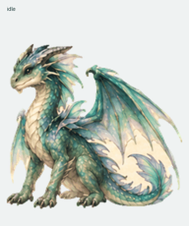
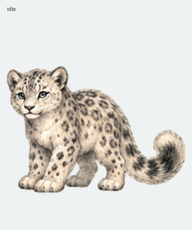
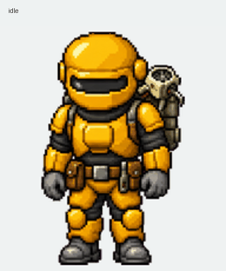

# KnightShift ChatGPT Work Pets

Three validated animated **v2 ChatGPT Work pet** sprite sheets, packaged for personal sharing:

| Pet | Default pose | Sprite sheet | Preview |
| --- | --- | --- | --- |
| Emerald Dragon — Left | Faces screen-left | [`pets/emerald-dragon-left/spritesheet.png`](pets/emerald-dragon-left/spritesheet.png) |  |
| Snow Leopard | Stage 3 | [`pets/snow-leopard/spritesheet.png`](pets/snow-leopard/spritesheet.png) |  |
| Engineer | Yellow armored engineer | [`pets/engineer/spritesheet.png`](pets/engineer/spritesheet.png) |  |

Each PNG is the exact validated export: `1536 × 2288`, transparent RGBA, 8 columns × 11 rows, 192 × 208 pixels per cell, with all 73 required v2 frames populated.

See [INSTALL.md](INSTALL.md) for the shortest way to add one to ChatGPT Work. Do not resize, flatten, optimize, or re-export the PNG before importing it; changing the encoded image may break validation.

The archive includes contact sheets, checksums, and a machine-readable manifest. Pet IDs are intentionally not included because each friend receives a new stable ID when creating their own copy.

## Integrity

From the repository root:

```bash
shasum -a 256 -c CHECKSUMS.sha256
```

All three sheets were independently revalidated with the ChatGPT Pets v2 validator immediately before packaging.

## Sharing note

These are personal creative assets supplied for personal, noncommercial sharing. The Engineer is fan art inspired by Factorio's armored engineer; this repository is not affiliated with or endorsed by Wube Software. See [LICENSE-ASSETS.md](LICENSE-ASSETS.md).
